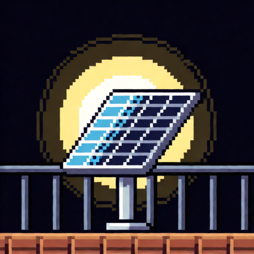
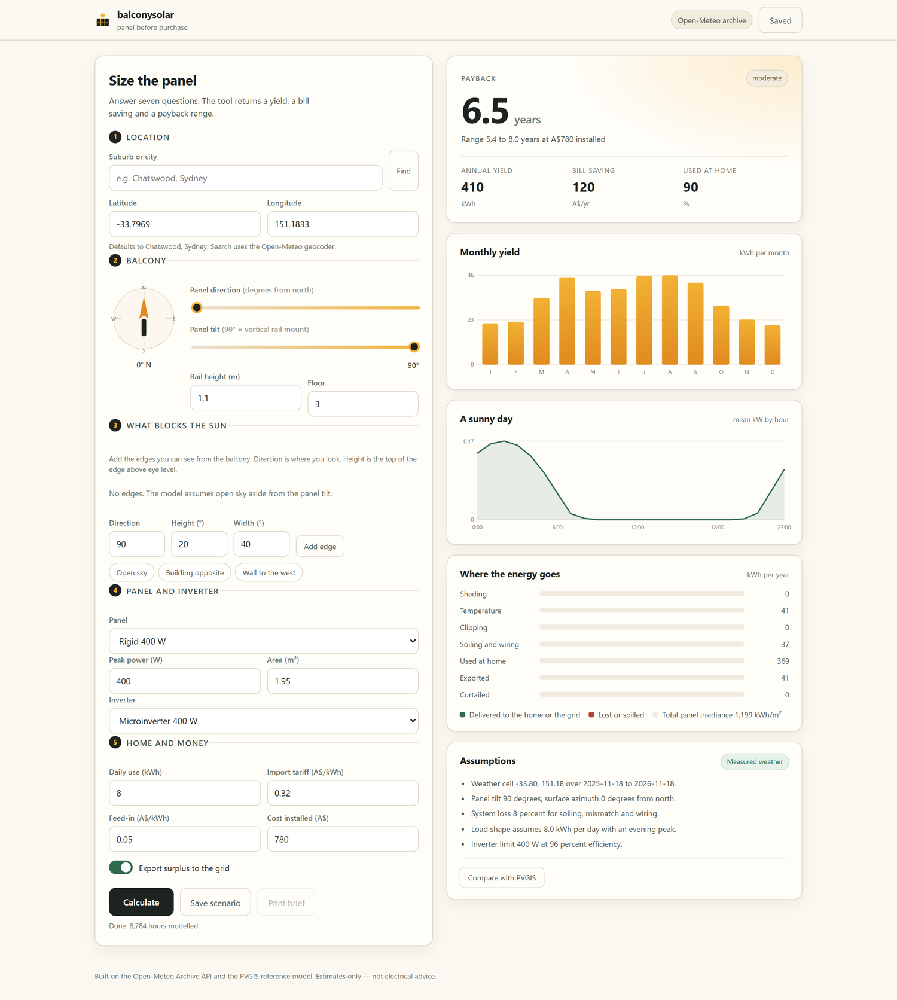
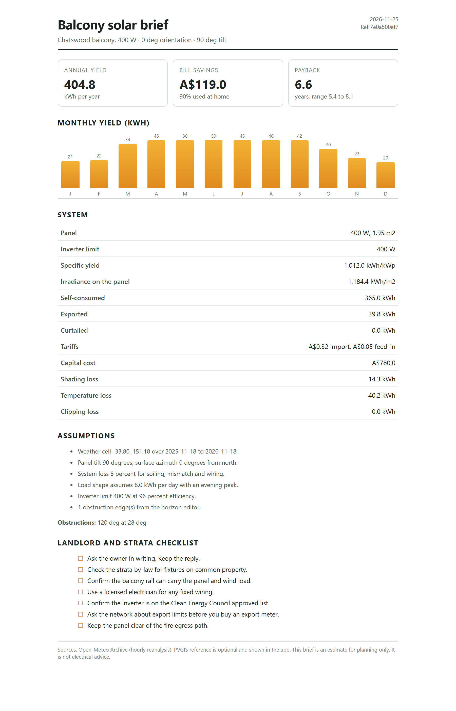

# balconysolar



A balcony solar sizer for renters. It turns one year of hourly weather into a yield, a bill saving and a payback range.

[](LICENSE)
[](#tests)
[](https://www.python.org/)
[](#quick-start)

## The problem

A renter cannot drill a roof. A balcony rail can hold one panel. The real question is whether that balcony gets sun.

A north-facing balcony on level 3 is not the same as a north-facing balcony behind a tower. Tilt matters. Rail height matters. A vertical panel loses most of the summer noon sun and gains winter sun.

Sales pages quote one number. This tool returns a range, a reason and the losses that sit behind it.

## What it does

Give it a location, an orientation, a tilt and the edges you can see from the balcony. It runs 8,784 hourly steps and returns:

- Annual yield in kWh, and specific yield in kWh per kWp.
- Self-consumed, exported, curtailed and imported energy.
- Bill saving from your own import and feed-in tariffs.
- A payback figure with a low and high range.
- A monthly chart, a mean-day curve and a loss breakdown.
- A printable A4 brief with a landlord and strata checklist.

## Features

- **Real weather, not a lookup table.** One year of hourly global, direct and diffuse irradiance from the Open-Meteo Archive API.
- **Horizon shading.** Add an obstruction by direction, height angle and width. The model blocks the beam and cuts the sky view.
- **Plane-of-array physics.** Solar position, angle of incidence, Hay-Davies diffuse transposition, ground reflection and a physical DNI cap.
- **Panel and inverter detail.** Peak power, area, temperature coefficient and NOCT. The AC limit produces a real clipping loss.
- **Honest money.** Self-consumption against an hourly load shape, zero-export support, and a payback range instead of one false number.
- **Offline fallback.** A clear-sky model keeps the tool useful when the network is down. The answer is labelled `modelled`.
- **No dependencies.** Python standard library, SQLite and hand-written SVG charts.

## Quick start

```bash
git clone https://github.com/fuleinist/balconysolar
cd balconysolar
python -m balconysolar --port 8770
```

Open <http://127.0.0.1:8770>. The app calculates a Sydney example on load.

Run the tests:

```bash
python -m unittest discover -s tests -t .
```

Compare the model with the PVGIS reference:

```bash
python scripts/compare_pvgis.py
```

## Screenshots



*The main view. Inputs on the left, payback, monthly yield, mean-day curve and loss breakdown on the right.*



*The printable brief. One page for a landlord, a strata committee or a fridge door.*

## How the model works

1. **Solar position.** NOAA declination and equation of time. Azimuth is measured from true north.
2. **Transposition.** Beam uses the angle of incidence. Diffuse uses the Hay-Davies sky model with a clamped circumsolar ratio. Ground reflection uses an albedo of 0.20.
3. **Shading.** A 36-bin horizon profile blocks the beam and scales the sky view factor.
4. **Cell temperature.** The NOCT model, then a temperature coefficient on power.
5. **Conversion.** DC power, then the inverter efficiency and its AC limit. The difference is clipping.
6. **Self-consumption.** An hourly load shape scaled to your daily kWh. Surplus is exported or curtailed.
7. **Money.** Self-used energy at the import tariff, exports at the feed-in tariff. Payback is capital cost divided by annual saving.

## Validation

The model matches the PVGIS v5.2 reference for north-facing geometry in Sydney:

| Geometry | This model | PVGIS | Delta |
|---|---|---|---|
| 400 W, 45° tilt, north | 615.1 kWh | 613.6 kWh | +0.2% |
| 400 W, 20° tilt, north | 620.7 kWh | 607.6 kWh | +2.1% |
| 400 W, 90° tilt, north | 409.7 kWh | 389.0 kWh | +5.3% |

PVGIS applies a 14% loss figure. This model applies 8% system loss plus a temperature derate, so small differences are expected.

PVGIS is not a reliable check for vertical planes that face away from the equator. At 90° tilt in Sydney it rates a south-facing panel above a north-facing one. That result is physically implausible. Use the PVGIS button for north-facing checks only.

## Data sources

- [Open-Meteo Archive API](https://open-meteo.com/en/docs/historical-weather-api): hourly `shortwave_radiation`, `direct_normal_irradiance`, `diffuse_radiation` and `temperature_2m`. Free, no key. Cached for 30 days.
- [Open-Meteo Geocoding API](https://open-meteo.com/en/docs/geocoding-api): suburb and city lookup. Free, no key.
- [PVGIS v5.2 PVcalc](https://joint-research-centre.ec.europa.eu/photovoltaic-geographical-information-system-pvgis_en): reference annual yield. Free, no key.
- Panel and inverter presets: public datasheet values for common 200 to 500 W modules and 400 to 1000 W inverters.

## API

| Method | Path | Purpose |
|---|---|---|
| `GET` | `/api/health` | Liveness check. |
| `GET` | `/api/panels` | Panel and inverter presets. |
| `POST` | `/api/estimate` | Run the model. Pass `"offline": true` to skip the network. |
| `POST` | `/api/scenarios` | Run and save a scenario. |
| `GET` | `/api/scenarios` | List saved scenarios. |
| `GET` | `/api/scenarios/{id}` | Read one scenario. |
| `DELETE` | `/api/scenarios/{id}` | Delete one scenario. |
| `GET` | `/brief/{id}` | Printable A4 brief. |
| `GET` | `/api/pvgis` | PVGIS reference for a geometry. |
| `GET` | `/api/geocode?q=` | Place lookup. |

Example:

```bash
curl -s http://127.0.0.1:8770/api/estimate \
  -H "Content-Type: application/json" \
  -d '{"location":{"lat":-33.7969,"lon":151.1833},"balcony":{"azimuth":0,"tilt":90},
       "panel":{"wp":400,"area_m2":1.95},"obstructions":[{"azimuth":120,"elevation":28,"width":50}]}'
```

## Project layout

```
balconysolar/
  solar.py    solar position, transposition, horizon shading
  weather.py  Open-Meteo fetch, cache, clear-sky fallback
  model.py    panel, inverter, self-consumption, money
  pvgis.py    optional reference yield
  db.py       SQLite store
  server.py   HTTP API, static files, printable brief
  static/     single-page UI and SVG charts
tests/        46 unit and API tests
scripts/      PVGIS comparison and screenshot capture
```

## Limits

- The archive grid is 5 to 25 km. Local cloud and building shade can differ.
- The horizon model uses straight edges, not a photograph.
- Tariffs change. Edit them and read the range, not the midpoint.
- The tool is not electrical advice. Use a licensed electrician for fixed wiring.
- One year of weather is one sample. A warm or cloudy year moves the answer.

## License

MIT. See [LICENSE](LICENSE).